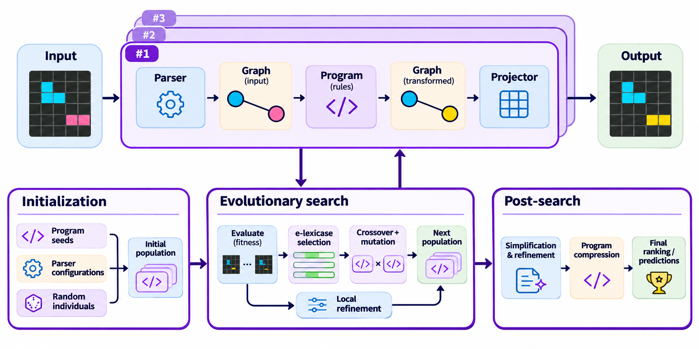

# Fairly Symbolic

*FairlySymbolic* co-evolves how a grid is parsed into a graph and the rewrite-rule program run on it, with no neural network. Programs express transformations through explicit symbolic operations on objects and their relationships, making it possible to examine how a result is obtained.

Results (see [arXiv:2611.13831](https://arxiv.org/abs/2611.13831) for details)

| Benchmark | Solved |
|---|---|
| ConceptARC | 99.4% |
| ARC-AGI-1 training | 49.3% |
| ARC-AGI-1 evaluation | 27.5% |
| ARC-AGI-2 public evaluation | 2.5% |
| ARGA 160-task ARC-AGI-1 subset | 54.4% |

If you use this work in your research, please cite:

> L. Favole, G. Mongardi, G. Squillero, A. Tonda; "Ceci n'est pas une pipe — Toward a Symbolic Solver for the Abstraction and Reasoning Corpus Using Evolutionary Computation"; [arXiv:2611.13831](https://arxiv.org/abs/2611.13831); 2026.

<details>
<summary>Full BibTeX entry</summary>

```bibtex
@misc{favole2026pipe,
  title = {Ceci n'est pas une pipe --- Toward a Symbolic Solver for the Abstraction and Reasoning Corpus Using Evolutionary Computation},
  author = {Favole, Luca and Mongardi, Giorgio and Squillero, Giovanni and Tonda, Alberto},
  year = {2026},
  eprint = {2611.13831},
  archivePrefix = {arXiv},
  primaryClass = {cs.AI},
  url = {https://arxiv.org/abs/2611.13831}
}
```
</details>

## Overview

*FairlySymbolic* is a purely symbolic, evolutionary solver for the Abstraction and Reasoning Corpus (ARC-AGI). Unlike approaches that rely on neural networks, pretrained models, or fixed object representations, our system jointly evolves three components of a candidate solution: a parser, a symbolic program, and a projector.

The central idea is that solving an ARC task requires more than identifying the correct transformations. It also requires finding a suitable abstraction of the input and a way to reconstruct the desired output. *FairlySymbolic* addresses this challenge through configurable graph-based representations, in which objects, subobjects, and their relationships provide the structures on which symbolic programs operate. By evolving the representation, transformations, and reconstruction together, the search can discover solutions that would be difficult to express using a fixed abstraction.

.

Each candidate solution consists of three interconnected components:

- **Parser:** Converts the input grid into a structured graph representation. Nodes represent extracted objects and additional structures, while edges encode spatial and structural relationships. The parser configuration controls how objects are identified, decomposed, and connected, allowing the evolutionary search to explore different abstractions of the same input.
- **Symbolic program:** Applies a sequence of rules expressed in a domain-specific language (DSL). Rules combine selectors operating on the graph with transformations such as movement, recoloring, and structural manipulation. The scene can be re-parsed between rules, allowing subsequent operations to act on updated objects and relationships.
- **Projector:** Reconstructs the output grid from the transformed scene graph, with configurable policies governing how objects and their transformations are rendered.

### ARC Prize 2026's Kaggle submissions:

- ARC-AGI-2: [notebook](https://www.kaggle.com/code/lucafavole/arc-2026-graph-solver-submission/notebook?scriptVersionId=364794876) (submission ID 57900372)
- Paper Track: [writeup](https://www.kaggle.com/competitions/arc-prize-2026-paper-track/writeups/new-writeup-1794056051373)

## Gory Details

### Build

```sh
make -j8
```

Any C++17 compiler on Linux or macOS works. Windows is not supported (the runtime uses POSIX calls); use WSL there.

Keep the flags in the `Makefile`. `-ffp-contract=off` stops fused multiply-add from changing floating-point results, and `-fno-builtin-pow` stops the compiler from replacing `pow(x, 0.5)` with a square root, so results stay the same across machines.

### Run

```sh
./arc_solver --data-dir path/to/tasks --out submission.json
```

`--data-dir` takes a flat folder of ARC task files (`<task_id>.json`). `--kaggle DIR --split training|evaluation|test` reads the layout of the ARC Prize dataset on Kaggle instead. The output follows the ARC Prize format: for every task, one `{attempt_1, attempt_2}` pair per test input.

```sh
./arc_solver --help
./arc_solver --data-dir DIR --progress-dir runs/myrun
```

`arc_config.conf` is read from the working directory (or from `--config FILE`). Settings are applied in this order, later ones winning: built-in defaults, the config file, `ARC_*` environment variables, command-line flags.

### Determinism

By default every task runs a fixed number of generations (60 per restart, 5 restarts, population 40). Each task seeds its random generator from its own identifier, so the output depends only on the seed and the configuration: `--n-workers 1` and `--n-workers 8` give the same `submission.json`.

A time limit is applied only when `--max-task-seconds` is given on the command line. The search then stops on the clock, and the result also depends on the speed and load of the machine.

### Reproducing the Results

Runs reported in [arXiv:2611.13831](https://arxiv.org/abs/2611.13831) used the configuration in this repository, the flags below, and a time limit per task (840 or 3,840 seconds; seeds 47, 41 and 42):

```sh
export ARC_CONCEPT_SEEDS=0 ARC_GENERALISE=1 ARC_INFORMED_ATTR=1 ARC_IMMIGRANTS=4 \
       ARC_NO_GUARDS=1 ARC_VOTE_TYPES=1 ARC_TASK_OTHER=1 ARC_MDL_PRIOR=1 \
       ARC_REENC_CACHE=1 ARC_VOTE_FIT=2 ARC_FITLOG=1
./arc_solver --config arc_config.conf --seed 47 \
    --data-dir path/to/ARC-AGI-1/evaluation \
    --max-task-seconds 840 --generations 100000000 --n-workers 17 \
    --out submission.json --progress-dir runs/g1eval-840-s47 --full-results
```

For ARC-AGI-2, replace `--data-dir` with `--kaggle path/to/arc-prize-2026-arc-agi-2 --split training` (or `evaluation`). They ran 17 tasks at a time on a 36-thread Intel Xeon Gold 6140. Because the runs are bounded by time, a rerun on another machine gives close but not identical numbers. The benchmark data is not included.

### Layout

```
include/arc/   public headers; every source includes "arc/<name>.hpp"
src/
  util/        random numbers, hashing, JSON, number formatting
  graph/       grids and graph containers
  encode/      the parser, one file per step
  dsl/         the program language: selectors, actions, executor, projector
  fitness/     object and pixel distances, lexicase cases
  search/      genetic search, genome encoding, restarts, seed programs
  runtime/     configuration, task input/output, main
```

## Authors

- Luca Favole [&lt;lucafavole0@gmail.com&gt;](mailto:lucafavole0@gmail.com)
- Giorgio Mongardi [&lt;giorgio.mongardi@polito.it&gt;](mailto:giorgio.mongardi@polito.it)
- Giovanni Squillero [&lt;giovanni.squillero@polito.it&gt;](mailto:giovanni.squillero@polito.it)
- Alberto Tonda [&lt;alberto.tonda@inrae.fr&gt;](mailto:alberto.tonda@inrae.fr)

## License

Copyright 2026 INRAE / Politecnico di Torino  
Distributed under a [MIT No Attribution](LICENSE) (MIT-0)
